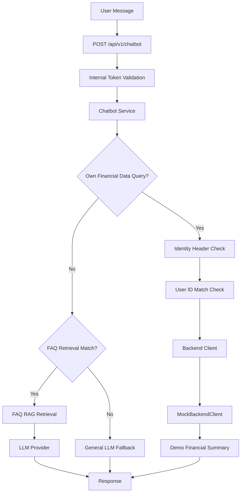

# Day 8 — Department 3 Final Review & Verification

**Intern:** Purnoor Zafar  
**Project:** HisabDo AI Business Assistant  
**Department:** Department 3  
**Date:** 7 November 2026  
**Repository:** https://github.com/usmankhalid172/hisabdo-webapp-ai  
**Branch:** `purnoor-zafar-ai-intern`  
**Status:** Prepared for review — production verification pending

## 1. Objective

Review the current Department 3 financial chatbot implementation, inspect previous phase evidence, evaluate 25 candidate financial queries, categorize identified issues, prioritize risks, propose responsible roles, and document the current system flow.

This review distinguishes confirmed repository/local test evidence, observed local/mock behavior, historical results, and items not verified in production.

## 2. Previous Phase Results

### 2.1 Day 7 Final Evaluation

The previous Day 7 handover recorded:
- Full test suite: 353 passed, 4 skipped.
- FAQ retrieval evaluation: 10/10 checks passed.
- Expense model: 397 training records and 103 test records.
- Accuracy: 78.64%.
- Weighted precision: 85.92%.
- Recall: 78.64%.
- F1 score: 79.03%.

Limitations recorded at that time:
- Production financial API integration was not verified.
- Production session isolation was not verified.
- Production latency and API costs were not measured.
- The expense model results did not establish measurable improvement over baseline.
- Production security clearance was not granted.

These are historical Day 7 results, not a new full-suite execution for this review.

### 2.2 Earlier Security and Monitoring Evidence

Previous documentation recorded:
- Day 1 security/privacy targeted tests: 62 passed.
- Day 3 monitoring runbook: 353 passed, 4 skipped.
- Day 7 security-related tests: 38 passed.
- Local mock/TF-IDF performance measurements were recorded, but they are not production measurements.
- Safe logging work recorded intent, source, outcome, latency and token metadata while avoiding sensitive content in the intended logging path.

Passing automated tests do not establish complete production security or live integration.

## 3. Current System Flow

### 3.1 Repository-Observed Flow



### 3.2 Flow Notes and Limitations

- The chatbot router applies the internal token dependency.
- Personal financial queries require an authenticated user ID header.
- A mismatched payload user ID is rejected.
- The inspected `get_backend_client()` returns `MockBackendClient()`.
- The mock client returns hardcoded demo figures, not verified customer financial records.
- FAQ queries use `faq_rag.py` and the FAQ knowledge base.
- General queries can reach the general LLM fallback.
- The service uses keyword/regex-based intent detection in several flows.
- The separate `/api/v1/ai/chat` route in `src/integration/routes.py` was not found registered in `src/main.py` during inspection.
- Upstream trustworthiness of the identity header and the complete production integration path remain unverified.

This is a source-code inspection diagram, not proof of a live production deployment.

## 4. Chatbot and API Inspection

### 4.1 Main Files Inspected

| File | Finding |
|---|---|
| `src/main.py` | Registers infrastructure, chatbot, categorization and XICTEK website routers. |
| `src/financial_assistant/router.py` | Defines `/api/v1/chatbot` and internal token dependency. |
| `src/financial_assistant/service.py` | Handles intent routing, FAQ retrieval, backend calls and response handling. |
| `src/integration/backend_client.py` | `get_backend_client()` returns `MockBackendClient()`. |
| `src/security.py` | Validates the internal service token. |
| `src/financial_assistant/faq_rag.py` | Loads FAQ documents and performs retrieval. |
| `src/financial_assistant/intent_router.py` | Handles supported conversational intents and slots. |
| `src/financial_assistant/prompts.py` | Contains grounding, safety and response instructions. |
| `src/integration/routes.py` | Defines a separate application-facing `/api/v1/ai/chat` route. |

### 4.2 API Test Evidence

Command executed during this review:

```powershell
python -m pytest .\tests\test_chatbot.py .\tests\test_integration_api.py .\tests\test_health_version.py -v
```

Recorded result:
- 24 passed.
- 0 failed.
- 1 warning.
- Runtime: 0.24 seconds on the latest repeated run (another run recorded 0.25 seconds).

The warning concerns deprecated Starlette constant `HTTP_422_UNPROCESSABLE_ENTITY`; the suggested replacement is `HTTP_422_UNPROCESSABLE_CONTENT`.

These are local automated tests. They do not prove production API availability or real backend connectivity.

## 5. Candidate Query Evaluation — 25 Queries

### 5.1 Test Method and Limitations

The 25 candidate questions were executed through the local `handle_chat()` service-level harness.

- The harness did not call the HTTP router endpoint.
- Router-level authentication dependencies were therefore not exercised by this 25-query run.
- Results reflect the local/mock environment, not production.
- The mock backend returns fixed demo figures.
- A generic response or routing mismatch is an observed behavior, not automatically a confirmed production defect.

### 5.2 Query Results

| ID | Candidate query | Observed route/result |
|---|---|---|
| Q1 | What is my balance right now? | Own-finance route; generic mock summary |
| Q2 | Show me my current account balance | General LLM; no specific answer |
| Q3 | How much money do I have? | General LLM; no specific answer |
| Q4 | What is my total balance? | Own-finance route; generic mock summary |
| Q5 | How much did I spend this month? | Own-finance route; generic mock summary |
| Q6 | Show me my expenses | Own-finance route; generic mock summary |
| Q7 | What are my total expenses? | General LLM; no specific answer |
| Q8 | How much did I spend today? | Own-finance route; generic mock summary, not a today-specific result |
| Q9 | Show my expenses for this month | Own-finance route; generic mock summary |
| Q10 | Which category has the highest expenses? | Categorization route; asks user to describe a transaction |
| Q11 | How much did I spend on groceries? | Own-finance route; generic mock summary |
| Q12 | How much did I spend on transport? | Own-finance route; generic mock summary |
| Q13 | Show my recent transactions | General LLM; no specific answer |
| Q14 | What is my total income? | FAQ RAG; returns a revenue definition |
| Q15 | How much revenue did I earn? | Income intent; asks for amount |
| Q16 | Compare my income and expenses | Income intent; asks for amount |
| Q17 | Am I spending more than I earn? | Income intent; asks for amount |
| Q18 | Show my monthly financial summary | Report intent; empty collected details |
| Q19 | What is my remaining money? | General LLM; no specific answer |
| Q20 | How much money do customers owe me? | Third-party policy guard declines; possible false-positive |
| Q21 | Show my outstanding receivables | Own-finance route; generic mock summary |
| Q22 | What is my account status? | General LLM; no specific answer |
| Q23 | Show my spending by category | Categorization route; asks user to describe a transaction |
| Q24 | Give me my financial report | Report intent; empty collected details |
| Q25 | Why is my balance different from my income? | Own-finance route; generic mock summary |

### 5.3 Outcome Summary

| Observed outcome | Count |
|---|---:|
| Generic fixed mock summary | 10 |
| General fallback with no specific answer | 6 |
| Categorization intent mismatch | 2 |
| FAQ answer mismatch | 1 |
| Income intent incomplete follow-up | 3 |
| Report intent with empty details | 2 |
| Possible policy false-positive | 1 |
| **Total** | **25** |

Q20 requires product/business-context clarification. It is not evidence of a confirmed privacy breach.

## 6. Root Cause Categorization

### 6.1 Missing Sources

- Recent transaction, date-specific expense, category-wise spending and detailed report queries require transaction-level data.
- The inspected backend interface exposes a financial summary, not a verified transaction-history API.
- The current backend implementation is a mock.
- FAQ source URLs and last-verified dates are missing from the inspected FAQ records.

Evidence: `backend_client.py`, `faq_docs.json`, Q8, Q11–Q13, Q18, Q23 and Q24.

### 6.2 Retrieval Misses

- Own-financial-data detection uses a limited set of English patterns.
- Some personal finance questions are routed to the general LLM instead.
- FAQ retrieval uses `top_k=1` and a relevance threshold of 0.30 in the inspected implementation.
- Query-time OpenAI embedding failure returns no FAQ matches rather than falling back to TF-IDF.
- Several observed cases are intent-routing misses rather than confirmed FAQ retriever failures.

Evidence: `service.py`, `faq_rag.py`, Q2, Q3, Q7, Q13, Q19 and Q22.

### 6.3 Incorrect Sources

- Q14 asks for personal income but receives a general revenue definition.
- Personal finance requests can receive hardcoded mock/demo financial values.
- The inspected FAQ records have `source_verification` pending and null source URLs.

Evidence: `backend_client.py`, `faq_docs.json`, Q14 and Q1/Q4–Q6/Q8/Q9/Q11/Q12/Q21/Q25.

### 6.4 Answer Generation and Intent Handling

- Q15–Q17 trigger incomplete income follow-up behavior.
- Q18 and Q24 reach report intent with empty collected details.
- Q10 and Q23 are routed to transaction categorization instead of spending analytics.
- Q25 does not provide the requested balance-versus-income explanation.

Evidence: `intent_router.py`, `service.py`, Q10, Q15–Q18, Q23–Q25.

### 6.5 Safety and Privacy

- Internal token validation is implemented.
- Missing identity and mismatched identity checks are covered by local API tests.
- A third-party data guard exists.
- Q20 may incorrectly decline a request about the user's own customer receivables; this requires clarification and testing.
- Upstream identity trust and production cross-user isolation remain unverified.
- No confirmed privacy breach was identified in the reviewed test evidence.

Evidence: `router.py`, `security.py`, `service.py`, Q20 and targeted API test results.

### 6.6 API Integration Errors

- `get_backend_client()` returns `MockBackendClient()`.
- Real customer financial backend integration was not established by the inspected implementation.
- The separate `/api/v1/ai/chat` route was not found registered in `src/main.py`.
- Upstream identity forwarding/trust and live application integration remain unverified.

Evidence: `backend_client.py`, `main.py`, `integration/routes.py` and `router.py`.

## 7. Prioritized Issue List

| ID | Priority | Issue | Impact |
|---|---|---|---|
| D3-01 | Critical | Mock financial figures used for personal finance queries | Demo values may be mistaken for actual customer figures |
| D3-02 | High | Real financial backend integration missing/unverified | Actual balances, expenses and income cannot be verified |
| D3-03 | High | Upstream identity trust and production isolation unverified | Production privacy assurance is not established |
| D3-04 | High | Application-facing integration route not registered in inspected main app | Expected integration route is not shown available through the inspected app |
| D3-05 | Medium | Own-financial-data intent detection incomplete | Personal questions can fall through to general LLM |
| D3-06 | Medium | Income, report and analytics slot handling incomplete | Incomplete follow-ups and empty report details |
| D3-07 | Medium | FAQ source verification incomplete | Source authority and freshness cannot be established |
| D3-08 | Medium | FAQ retrieval limitations | Relevant answers can be missed |
| D3-09 | Low | Deprecated HTTP 422 constant warning | Compatibility and maintenance cleanup required |

Priority reflects assessed risk from inspected code and local observations. It does not establish that production customers have experienced these outcomes.

## 8. Proposed Ownership Matrix

The following are proposed team roles only. No named individual owner was confirmed by the reviewed repository documentation.

| Issue | Proposed accountable role | Responsibility / Expected action |
|---|---|---|
| D3-01 | Backend / Financial API Lead | Separate demo data from production responses and clearly label demo mode |
| D3-02 | Backend Integration Lead | Confirm API contract and connect verified financial records |
| D3-03 | Backend Security Lead | Verify trusted identity propagation and cross-user isolation |
| D3-04 | AI Integration Lead | Verify route registration, endpoint path and authentication flow |
| D3-05 | AI/ML Lead | Improve personal-finance intent patterns and evaluation coverage |
| D3-06 | AI/ML / Chatbot Lead | Complete report, income and analytics conversation flows |
| D3-07 | Product / Knowledge Base Owner | Confirm source URLs, approval, ownership and review dates |
| D3-08 | RAG / AI Lead | Evaluate retrieval settings and embedding failure fallback |
| D3-09 | QA / Maintenance Lead | Replace deprecated usage and rerun relevant tests |

**Named owner status:** TBD for all nine issues. Proposed roles require Team Lead confirmation.

## 9. Knowledge Base and Retrieval Notes

The inspected knowledge base contains:
- 16 FAQ records.
- Manifest version `1.1.0`.
- Source file `data/faq_docs.json`.
- FAQ IDs `faq-001` through `faq-006` and `finance_001` through `finance_010`.
- Source URLs and last-updated dates are null in the inspected records.
- Source verification status is pending.

The inspected FAQ retrieval implementation:
- Uses OpenAI embeddings when configured and available.
- Uses TF-IDF as an initialization-time fallback.
- Uses a 0.30 relevance threshold.
- Defaults to `top_k=1`.
- Returns no matches on query-time OpenAI embedding failure.

The separate `src/financial_assistant/rag/retriever.py` implementation and `rag_pipeline.py` also exist. The inspected chatbot service uses `faq_rag.py` directly rather than the separate context pipeline.

These overlapping implementations should be reviewed before selecting or changing a canonical retrieval path.

## 10. Verification Results and Limitations

### 10.1 Current Review Test

Command:

```powershell
python -m pytest .\tests\test_chatbot.py .\tests\test_integration_api.py .\tests\test_health_version.py -v
```

Latest repeated run:
- 24 passed.
- 0 failed.
- 1 warning.
- Runtime: 0.25 seconds.

### 10.2 Historical Test Results

The Day 7 handover recorded 353 passed and 4 skipped.

Earlier Day 27 documentation recorded 329 passed, 4 skipped and 4 warnings.

These historical results have different scopes and dates. They must not be presented as a new Day 8 full-suite execution.

### 10.3 Items Not Verified

- Live production financial backend connectivity.
- Actual customer financial records and transaction history.
- Production identity trust and cross-user session isolation.
- Live `/api/v1/ai/chat` application integration.
- Production latency and API costs.
- Production monitoring dashboards and alerts.
- Full 25-query behavior through the authenticated HTTP endpoint.
- Named ownership assignments and source-owner approvals.

### 10.4 Evidence Boundaries

- The 25 candidate query outcomes came from a local service-level harness, not the HTTP API.
- The mock financial summary is not actual customer data.
- A passing local test suite is not proof of production readiness.
- No production security clearance is claimed.
- No confirmed privacy breach is claimed.
- The generic 17 weak/failed queries from the Day 28 XICTEK website-assistant benchmark are not included as Department 3 financial chatbot failures.

## 11. Final Actions Required

1. Confirm the real financial backend API contract and data source.
2. Verify upstream authentication and trusted user identity propagation.
3. Test cross-user isolation using separate authenticated test accounts.
4. Verify or register the application-facing integration route as required by the intended architecture.
5. Improve and retest personal finance intent detection.
6. Complete report, income and analytics slot workflows.
7. Obtain approved FAQ sources and source-owner confirmation.
8. Evaluate FAQ retrieval and query-time embedding fallback behavior.
9. Confirm named accountable owners with the Team Lead.
10. Run the complete agreed test suite and retain the output as evidence.
11. Obtain review approval before committing and pushing the document.

## 12. Conclusion

The Department 3 review documents the inspected chatbot architecture, 25 local candidate-query outcomes, six root-cause categories, nine prioritized issues and a proposed ownership matrix.

The local targeted API/chatbot test run passed 24 tests with one deprecation warning. However, the current backend client returns mock financial data, and live financial API integration, production identity trust and production isolation remain unverified.

**Final status:** Documentation prepared for review. Production verification, named owner confirmation and approval remain pending.
