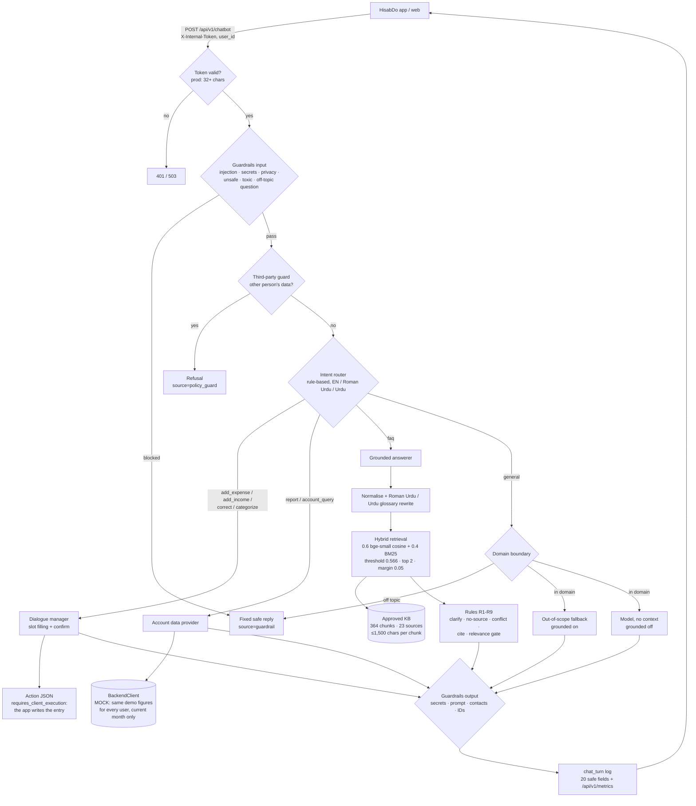

# Phase 2 / Day 1: Department 3 Current State Review and Priorities

**Author:** Fahad Zubairi (AI intern) · **Date:** 2026-11-05 · **Branch:** `FahadZubairi_AI`
**Evidence:** `data/phase2_review/probe_queries_v1.json` (50 expense-management queries, written before running),
`probe_replies_v1.json` (actual replies), `issue_list.csv` (this list as data); earlier results in
`docs/dept3-final-evaluation.md`, `retrieval-approach-comparison.md`, `grounded-answer-rules.md`, `safety-guardrails.md`.

**Summary:** of 50 fresh expense-management queries run through the release candidate with production settings
(guardrails on, grounded answers on, hybrid retriever, mock model, mock backend), **30 were weak or failed**. Together
with the open items from Phase 1 this gives **32 work items**: 9 API integration, 8 answer generation, 6 missing
source, 4 incorrect source, 3 safety / privacy (all false refusals, no leak), 2 retrieval miss. **Top risk: the
"authenticated backend" is still a mock** that returns the same demo figures for every user and only for the current
month; three answers present those figures as the answer to a different question.

No production user logs exist yet (the service has not been deployed with the new telemetry), so "user query logs"
here are the probe run plus the judged evaluation sets from Phase 1.

## 1. Current flow (as built, release candidate e2264f1)

| Stage | Current configuration | Inspected |
|---|---|---|
| Source ingestion | `clean_knowledge_sources.py --fetch`: 23 approved official pages → `data/kb/approved/` (manual run, every 30 days) | yes |
| Chunking | One chunk per FAQ question or page section; ≤1,500 characters, split at sub-headings or paragraphs | yes |
| Embeddings | `BAAI/bge-small-en-v1.5` (384 dimensions, English), local ONNX via fastembed; lexical BM25 fallback | yes |
| Retrieval / top-k | Hybrid α 0.6, threshold 0.566, top 2, margin 0.05, 20 candidates; router gate (faq only) | yes |
| System prompts | `SYSTEM_PROMPT` (all providers) + `GROUNDING_RULES` (knowledge route); default provider is the mock | yes |
| Fallbacks | no-source, out-of-scope, kb_unavailable, llm_error, backend_error, internal_error | yes |
| Authenticated API integration | Internal token only; `BackendClient` is `MockBackendClient` (fixed figures); figures only for the current month | yes |
| Logs | `chat_turn` (20 allowlisted fields), metrics in-process | yes |

## 2. Prioritized issue list by root cause

Priority: **P0** wrong or misleading financial answer, or a gap blocking real use · **P1** wrong source or route on a
common query · **P2** weak but safe answer · **P3** quality or operational improvement.

### API integration errors (9)

| ID | Priority | Query / finding | What happens | Owner |
|---|---|---|---|---|
| D3-01 | **P0** | All account flows | `BackendClient` is a mock: every user gets the same demo figures (balance 45,230.50). No real authenticated backend API is connected | Hassan Hussain (core services) |
| D3-02 | **P0** | Q14 "How much does Ali owe me?" | Returns the overall balance as if it were Ali's debt. The backend contract has no per-customer receivables | Hassan Hussain + Saba Talat |
| D3-03 | **P0** | Q17 "How much do I owe my suppliers?" | Returns the overall balance. No payables in the contract | Hassan Hussain + Saba Talat |
| D3-04 | **P0** | Q22 "biggest expense this week", Q23 "Is hafte kitna kharcha hua?" | Shows the **month's** totals labelled "this week" | Saba Talat (period handling) |
| D3-05 | P1 | Q21 "expenses by category" | Returns totals only; the contract has no category breakdown | Hassan Hussain |
| D3-06 | P1 | Q20, Q25 last month / compare months | "Only the current month" (honest), but blocks a core use case | Hassan Hussain |
| D3-07 | P1 | Q28 "Categorize: 1500 for printer ink" | Goes to the KB fallback; the `/api/v1/categorize` service is never called from chat | Saba Talat + categorization owner |
| D3-08 | P2 | Q05 "Paid the supplier 15k for stock" | Asks a category from a list without Inventory / Stock; a supplier payment (payables) is treated as a plain expense | Saba Talat |
| D3-09 | P2 | Q12, Q13 udhar given ("Ali ko 500 udhar diye") | Treated as an expense (asks its category) or "expense or income?"; the action contract has no udhar / receivable entry type | Hassan Hussain + Saba Talat |

### Answer-generation issues (8)

| ID | Priority | Query | What happens | Owner |
|---|---|---|---|---|
| D3-10 | **P0** | Q33, Q43, Q44, Q46 ("export my expenses to Excel", "are my expense records synced", "uninstall… lose my expenses", "can my accountant see my expenses") | Product / privacy questions containing "my expenses" go to the own-figures route; the reply is the balance, and the mock **echoes the question** ("Here's what I found: Balance… (In response to …)") | Saba Talat (router) + Muhammad Hamza Nawaz (mock provider echo) |
| D3-11 | P1 | Q06 "Spent 450 on tea for staff and 300 on snacks" | Two amounts in one message: asks "How much was it?" | Saba Talat |
| D3-12 | P1 | Q08 "galti ho gayi, 450 nahi 540 tha" | Correction not recognised (open since Phase 1) | Saba Talat |
| D3-13 | P2 | Q48 "expenses" | Out-of-scope fallback instead of a clarifying question (router sends one-word topics to `general`, where R1 is not reached) | Fahad Zubairi |
| D3-14 | P2 | H-TC-08 "Have you sent the payment to my customer?" | Routed `faq` since the 3 Nov fix; cites an overdue-balance article | Saba Talat |
| D3-15 | P2 | Q07, Q09 edit / delete last expense | Only entries confirmed in the same chat can be changed; others redirect to the app (safe, limited) | Saba Talat |
| D3-16 | P3 | Real model provider not enabled | All English answers are extractive; no wording quality measured with a real model | Muhammad Hamza Nawaz |
| D3-17 | P3 | Hindi / Arabic | App supports them; no rewrite glossary, router cues or guard patterns | Fahad Zubairi + Saba Talat |

### Missing sources (6)

| ID | Priority | Query | What happens | Owner |
|---|---|---|---|---|
| D3-18 | P1 | Q29 "How do I add an expense?", Q30 "edit an expense", Q35 "change category" | No official how-to page: cites general blog advice (labelled related topic) | Mian Usman Khalid (content) + Fahad Zubairi (ingest) |
| D3-19 | P1 | Q32 receipt photo · Q34 monthly budget · Q37 recurring expenses · Q38 two staff on one account | Feature questions with no official answer (cites neighbouring topics, or no source) | Mian Usman Khalid |
| D3-20 | P1 | Q45 currencies (audit C-06) | Sources disagree (AED); conflict shown and flagged | Mian Usman Khalid |
| D3-21 | P2 | `/delete-data` and 5 other sitemap pages | Not audited, so not in the KB | Fahad Zubairi |
| D3-22 | P2 | Website | 95 broken blog links, stale "30 questions", 5 undated pages | Website owner (Mian Usman Khalid to assign) |
| D3-23 | P3 | Q41 petty cash, Q42 cash reserve (Roman Urdu / English) | Answered from blogs only; no product guidance | Mian Usman Khalid |

### Incorrect sources (4)

| ID | Priority | Query | What happens | Owner |
|---|---|---|---|---|
| D3-24 | P1 | Q36 "خرچ کی رپورٹ پی ڈی ایف میں کیسے بنائیں؟" | Cites "Expense Reports: What to Include" instead of the PDF export FAQ | Fahad Zubairi |
| D3-25 | P1 | Held-out: 3 unrelated citations remain (H-KHA-EN-2 and 2 others) | Unrelated passage cited | Fahad Zubairi |
| D3-26 | P2 | "Can I connect HisabDo to my bank account?" | Answered from "What happens when I sign in?" | Fahad Zubairi |
| D3-27 | P2 | "Does HisabDo have a web version?" | Answered with the Android version requirement | Fahad Zubairi |

### Safety / privacy (3, all false refusals; no leak found)

| ID | Priority | Query | What happens | Owner |
|---|---|---|---|---|
| D3-28 | **P0** | Q15 "Which customers still owe me money?", Q16 "Mera kitna udhar baqi hai customers par?" | Refused as another person's data; these are the user's own receivables | Fahad Zubairi (guard) + Saba Talat |
| D3-29 | P1 | Q50 "Why is my total wrong?" | Blocked as off-topic ("total" not a domain word) | Fahad Zubairi |
| D3-30 | P3 | Guardrails pattern-based; same author for rules and attacks | Red-team suite v1.2 by another member | Syeda Isma Nazir (QA) |

### Retrieval misses (2)

| ID | Priority | Query | What happens | Owner |
|---|---|---|---|---|
| D3-31 | P1 | Urdu-script questions | Weakest language (glossary-based rewrite, English-only embeddings) | Fahad Zubairi |
| D3-32 | P2 | Lexical fallback mode | 8 unrelated citations vs 3 in hybrid; servers without fastembed are weaker | Fahad Zubairi + Platform |

### Counts

| Root cause | P0 | P1 | P2 | P3 | Total |
|---|---|---|---|---|---|
| API integration | 4 | 3 | 2 | 0 | 9 |
| Answer generation | 1 | 2 | 3 | 2 | 8 |
| Missing source | 0 | 3 | 2 | 1 | 6 |
| Incorrect source | 0 | 2 | 2 | 0 | 4 |
| Safety / privacy | 1 | 1 | 0 | 1 | 3 |
| Retrieval miss | 0 | 1 | 1 | 0 | 2 |
| **Total** | **6** | **12** | **10** | **4** | **32** |

Probe results by flow (50 queries): expense entry 4/6 good · income 2/2 · udhar 0/2 · receivables / payables 0/4 ·
balance 1/1 · reports 3/8 (honest limits counted as gaps) · categorization 1/2 · app how-to 0/10 · concepts 3/4 ·
policy 0/3 (+1 conflict) · privacy 1/2 · ambiguous 1/3.

## 3. Work ownership matrix

Owners are proposed from the repository history and earlier assignments; **the Team Lead confirms**.

| Owner | Role | Items (priority) | First deliverable |
|---|---|---|---|
| Hassan Hussain | Core services / backend API | D3-01 (P0), D3-02 (P0), D3-03 (P0), D3-05, D3-06, D3-09 | Real authenticated `BackendClient` with per-customer receivables, payables, category totals and any period |
| Saba Talat | Intent router and dialogue | D3-02, D3-03, D3-04 (P0), D3-07, D3-08, D3-09, D3-10 (P0, router), D3-11, D3-12, D3-14, D3-15, D3-28 (with Fahad) | Week / period honesty fix; "my expenses + how / synced / export / accountant" to `faq`; udhar and supplier-payment intents |
| Fahad Zubairi | KB, retrieval, grounded answers, guardrails, telemetry | D3-13, D3-17, D3-18 (ingest), D3-21, D3-24, D3-25, D3-26, D3-27, D3-28 (P0), D3-29, D3-31, D3-32 | Fix the own-customers false refusal (D3-28) and the "total" false positive; Urdu PDF citation |
| Muhammad Hamza Nawaz | LLM integration | D3-10 (mock echo), D3-16 | Remove the question echo from the mock; enable and measure one real provider |
| Mian Usman Khalid | Team Lead / product content | D3-18, D3-19, D3-20, D3-22 (assign), D3-23 | Publish official how-to pages (add / edit expense, categories, receipts, budgets, recurring, staff); decide AED |
| Syeda Isma Nazir | QA | D3-30; re-run this probe after each fix | Red-team suite v1.2; probe v1 as a regression gate |
| Categorization owner (team to name) | `/api/v1/categorize` | D3-07 | Chat route for "categorize: …" |
| Platform (team to name) | Deployment | D3-32, telemetry export, `TELEMETRY_SALT` | fastembed in production; metrics export |

### Order of work (proposed)

1. **This week (P0):** D3-01 real backend contract (blocks D3-02, D3-03, D3-05, D3-06); D3-04 week mislabel;
   D3-10 router + mock echo; D3-28 own-customers false refusal.
2. **Next (P1):** official how-to content (D3-18, D3-19) then re-ingest; categorize from chat (D3-07); multi-amount
   and correction parsing (D3-11, D3-12); Urdu citations (D3-24, D3-31).
3. **Then (P2 / P3):** remaining items, with the probe set re-run after each fix as a regression check.
