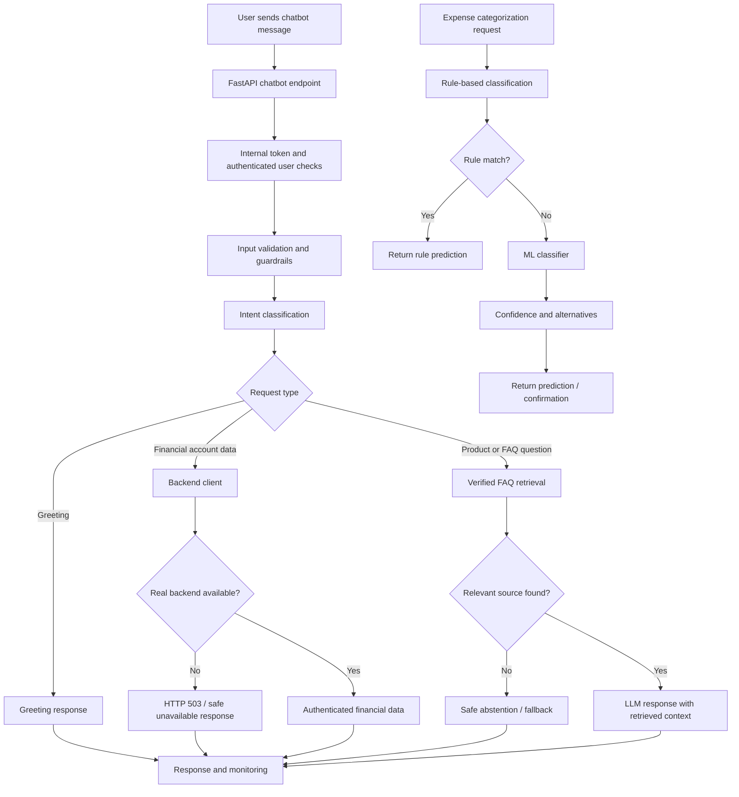

# Department 3 — Phase 2 / Day 1 Operational Audit

**Date:** 5 November 2026  
**Project:** HisabDo Expense Management Chatbot  
**Focus:** Current State Review, Operational Gaps and Priority Setting

## 1. Executive Summary

The Department 3 review examined the chatbot architecture, retrieval implementation, knowledge base, backend integration, guardrails, monitoring, expense categorization pipeline, tests, evaluation dataset and available historical performance reports.

The review identified the following readiness gaps:

- Retrieval evaluation: 30 MATCH, 11 MISS, 13 SAFE_ABSTENTION and 6 REVIEW.
- Verified-source retrieval match rate: 30/41 = **73.17%**.
- The 73.17% figure measures source matching, not chatbot answer accuracy.
- The real authenticated financial backend is not connected; the current backend client returns HTTP 503.
- Expense categorization uses a small synthetic dataset of 39 records across 10 categories.
- Four advanced financial capabilities remain skipped in the reviewed test suite.
- The actual generated answers for all 60 evaluation questions have not yet been scored.
- Multiple retrieval implementations and configurations require clearer ownership and standardization.
- Production backend readiness, real-account isolation and end-to-end behavior remain unverified.

**Overall assessment:** The project has useful safety controls, authentication checks, retrieval tests and evaluation infrastructure, but it is not ready for unrestricted production use.

## 2. Current System Flow

### Flow observations

- The chatbot route uses authentication and account identity checks.
- The main chatbot service uses the FAQ retrieval path through `faq_rag.py`.
- Account-specific requests depend on the backend client.
- The current backend implementation is a mock unavailable-backend implementation.
- Expense categorization follows a separate rule-based and ML pipeline.
- Health endpoint success confirms service liveness, not financial backend readiness.
- Retrieved context is passed to the LLM with source-grounding and safety instructions.
- Unavailable or unverified information should result in a safe fallback rather than invented financial figures.

## 3. Evaluation Evidence

| Evaluation result | Count |
|---|---:|
| MATCH | 30 |
| MISS | 11 |
| SAFE_ABSTENTION | 13 |
| REVIEW | 6 |
| **Total questions** | **60** |

**Verified-source questions:** 41  
**Correct source matches:** 30  
**Source match rate:** **73.17%**

SAFE_ABSTENTION is not automatically a failure. For unverified product claims and private financial information, refusing to guess is the correct behavior.

The 60-question dataset has not yet been run through the complete live chatbot and scored for generated-answer quality.

### Other reviewed evidence

- Automated test suite: 408 passed, 4 skipped, 0 failed, 2 warnings.
- Authentication checks: 4/4 passed in the reviewed test evidence.
- User-isolation test: 1 passed using synthetic users and a fake backend.
- Local FAQ retrieval latency: average 18.47 ms; p95 21.07 ms. This is retrieval-only, not end-to-end production latency.
- Expense categorization dataset: 39 records and 10 categories.
- Categorization tests reviewed: 6 basic tests.
- Historical 24-scenario Day 17 run did not provide actual chatbot answers; results were N/A/offline/blocked. These are not confirmed live user failures.
- The reviewed categorization model uses TF-IDF and Logistic Regression, with rule-based classification attempted first.
- The reviewed backend client raises a service-unavailable error instead of returning fabricated financial figures.

## 4. Prioritized Issue List

**Evidence labels:**

- **Confirmed:** Directly established by reviewed code or test results.
- **Evaluation gap:** Observed in the offline retrieval evaluation.
- **Risk / pending validation:** Requires further testing before claiming an actual production failure.

| ID | Priority | Root cause | Issue / evidence | Recommended action |
|---|---|---|---|---|
| D3-01 | P1 | API integration | Real financial backend is not connected; mock client returns 503. Confirmed. | Integrate authenticated backend. |
| D3-02 | P1 | API integration | Account-specific balance query D3-018 cannot be fulfilled by current backend. | Implement and test financial summary endpoint. |
| D3-03 | P1 | API integration | Roman Urdu payable query D3-020 has no usable account-data response. | Connect backend and validate intent routing. |
| D3-04 | P1 | API integration | D3-052 asks for current balance, but product source and real backend are unavailable. | Verify backend contract and safe fallback. |
| D3-05 | P1 | Safety/privacy | D3-057 requests another customer's balance; irrelevant Udhar material was retrieved. This is a retrieval safety risk, not proof of data disclosure. | Verify refusal before answer generation and test account isolation. |
| D3-06 | P1 | Missing sources | D3-051 asks about AI training and privacy; no verified supporting source. | Add approved privacy documentation. |
| D3-07 | P1 | Missing sources | D3-054 asks about privacy policy claims; verified source is missing. | Add approved policy source and review wording. |
| D3-08 | P1 | Missing sources | D3-055 asks about security guarantees; verified source is missing. | Add security documentation; avoid unsupported promises. |
| D3-09 | P1 | API integration | Transaction-level, budget, historical comparison and trend capabilities remain among four skipped test areas. | Implement or explicitly document unsupported capabilities. |
| D3-10 | P1 | API integration | Expense/income capture response states transaction details are not saved. | Connect transaction-write API or clearly retain limitation. |
| D3-11 | P1 | Retrieval miss | D3-003 returns Udhar guidance instead of the expected HisabDo overview source. Evaluation gap. | Improve intent-specific retrieval. |
| D3-12 | P1 | Incorrect source | D3-007 retrieves Udhar guidance instead of Khata guidance. Evaluation gap. | Improve source relevance and ranking. |
| D3-13 | P1 | Retrieval miss | D3-008 receives no retrieval result for lending/receiving money. Evaluation gap. | Add query variants and validate Khata source coverage. |
| D3-14 | P2 | Retrieval miss | D3-016 misspelled customer-balance query receives no relevant result. Evaluation gap. | Add typo-tolerant retrieval tests. |
| D3-15 | P2 | Incorrect source | D3-019 exact Udhar-entry steps retrieve a different expected source. Evaluation gap. | Verify workflow documentation and source mapping. |
| D3-16 | P2 | Retrieval miss | D3-025 export-button query receives no relevant source. Evaluation gap. | Add verified PDF navigation guidance if officially supported. |
| D3-17 | P2 | Retrieval miss | D3-027 misspelled PDF export query receives no result. Evaluation gap. | Test spelling variation and query normalization. |
| D3-18 | P2 | Incorrect source | D3-036 Roman Urdu revenue/profit comparison retrieves an unsuitable source. Evaluation gap. | Improve multilingual source matching. |
| D3-19 | P2 | Incorrect source | D3-040 misspelled cashflow question retrieves a different finance source. Evaluation gap. | Improve typo handling and expected-source mapping. |
| D3-20 | P2 | Incorrect source | D3-042 automatic categorization query retrieves unrelated sources. Review required. | Add verified categorization documentation and relevance tests. |
| D3-21 | P2 | Incorrect source | D3-046 explanation of expense categorization retrieves sources requiring relevance review. | Review source relevance and ranking. |
| D3-22 | P2 | Incorrect source | D3-047 available categories query retrieves unrelated Khata/overview sources. | Add an approved category list source. |
| D3-23 | P2 | Incorrect source | D3-050 categorization steps retrieve an unsuitable source. | Add verified workflow documentation. |
| D3-24 | P2 | Missing sources | D3-041 asks about expense categorization workflow; no verified source exists. | Add approved workflow documentation. |
| D3-25 | P2 | Missing sources | D3-043 asks about automatic category prediction; verified support is missing. | Document actual supported behavior. |
| D3-26 | P2 | Missing sources | D3-044 asks about ML categorization; verified product explanation is missing. | Add approved documentation without overstating capability. |
| D3-27 | P2 | Missing sources | D3-045 asks about available categories; verified source is missing. | Publish approved category list. |
| D3-28 | P2 | Missing sources | D3-048 asks how to correct a wrong category; verified workflow is missing. | Document supported correction workflow. |
| D3-29 | P2 | Missing sources | D3-049 asks about uncertain predictions; verified confidence behavior is missing. | Document confirmation behavior. |
| D3-30 | P2 | Incorrect source | D3-056 support-phone query retrieves unrelated FAQ material. | Add official contact details only after verification. |
| D3-31 | P2 | Missing sources | D3-053 asks about fallback policy; supporting product source is unavailable. | Document approved fallback behavior. |
| D3-32 | P2 | Missing sources | D3-059 ambiguous account query lacks verified supporting information. | Clarify the request and validate authenticated backend data. |
| D3-33 | P2 | Missing/conflicting sources | D3-060 contains conflicting unverified source drafts. | Review and approve one authoritative source before indexing. |
| D3-34 | P2 | Retrieval architecture | Multiple retriever implementations and different thresholds/top-k settings exist. | Confirm active paths and standardize configuration. |
| D3-35 | P2 | Retrieval architecture | Main FAQ vector index is in memory and whole FAQ records are indexed without explicit chunk-size/overlap configuration. | Evaluate persistence and document-level retrieval design. |
| D3-36 | P2 | Monitoring | Monitoring counters are process-local and reset on restart. | Add persistent metrics and operational dashboards. |
| D3-37 | P2 | Monitoring | Retrieval success/empty counters are defined, but their increments were not confirmed in the reviewed main service path. | Verify instrumentation and add tests. |
| D3-38 | P2 | ML/data quality | Categorization model uses only 39 synthetic sample records. | Obtain approved representative labeled data. |
| D3-39 | P2 | ML/data quality | Dataset has limited visible Roman Urdu, Urdu and typo variation. | Add reviewed multilingual evaluation examples. |
| D3-40 | P2 | ML/data quality | Categorization tests do not establish confidence calibration or generalization on real expenses. | Add independent test data and calibration evaluation. |

**Important interpretation:** Retrieval misses and review cases above are offline evaluation findings, not confirmed production-user incidents. Missing-source cases are coverage gaps. The D3-057 retrieval result is a privacy-related risk requiring end-to-end verification; it does not establish that another customer's data was disclosed. Safety and answer-generation behavior must be tested before claiming a confirmed violation or generation failure.

## 5. Architecture and Quality Risks

### 5.1 Retrieval and knowledge base

- Main FAQ retrieval uses verified documents and a relevance threshold.
- Default retrieval top-k is 3, with a maximum of 10.
- The main FAQ index is in memory.
- Separate retrieval implementations have different schemas and configurations.
- The active production path should remain clearly documented and tested.
- Selected query types are intentionally restricted by allowlists; their intended routing should be validated.
- The reviewed FAQ retrieval path uses `all-MiniLM-L6-v2` embeddings and a configured relevance threshold of 0.40.
- The separate TF-IDF retriever has a different threshold and top-k configuration; these scores are not directly comparable.
- No explicit chunk-size/overlap configuration was identified in the reviewed main FAQ indexing implementation.

### 5.2 Expense categorization

- Rule-based classification runs before ML fallback.
- ML uses TF-IDF and Logistic Regression.
- The training data is a small synthetic sample of 39 records.
- Rule-based matching uses keyword and substring checks.
- Urdu-script text is stripped by the current rule text normalization.
- The visible sample data primarily contains simple English descriptions and known merchants.
- The reviewed tests do not establish real-world accuracy or confidence calibration.

### 5.3 Safety and API

- Authentication and user identity checks exist.
- Guardrails validate input and wrap untrusted context.
- Central exception handling returns generic internal-server errors.
- Third-party financial data requests should be refused.
- Real backend integration and production identity isolation remain unverified.
- The current backend client raises HTTP 503 for personal financial summaries.
- A successful health check does not establish that the financial backend is operational.

### 5.4 Monitoring and answer generation

- Monitoring records allowlisted event and error metadata.
- Monitoring counters are held in process memory.
- Query text and financial values are not intended to be logged.
- The reviewed main service uses retrieved context for grounded product answers.
- The actual response quality across the full 60-question dataset remains unscored.
- The alternate LLM service/provider path should be distinguished from the main chatbot route during future integration testing.

## 6. Work Ownership Matrix

The following is a **proposed ownership allocation based on previously recorded module history**. Historical authorship does not automatically establish current task ownership. The Department 3 lead must confirm the assignments.

| Workstream | Proposed accountable owner | Responsibility | Priority |
|---|---|---|---|
| Prompt and response policy | Rameesha Zafar — proposed; confirm | Prompt consistency, safe responses and source-grounding rules | P1 |
| LLM service/provider | Muhammad Hamza Nawaz — proposed; confirm | Provider reliability, error handling and response validation | P1 |
| End-to-end evaluation and QA | Joyce Hany — proposed; confirm | Run 60 questions, score responses and verify safety cases | P1 |
| RAG and knowledge base | Department 3 RAG/KB maintainer — name to confirm | Source approval, retrieval misses, ranking and indexing | P1 |
| Backend/API integration | Department 3 backend owner — name to confirm | Authenticated financial data and transaction API integration | P1 |
| Expense categorization | Department 3 ML/data owner — name to confirm | Dataset quality, model evaluation and rule coverage | P2 |
| Monitoring and release readiness | Department 3 lead — name to confirm | Persistent monitoring, production readiness and final sign-off | P1 |

**Ownership action:** The Department 3 lead should confirm the proposed named owners and fill the pending names before treating the matrix as final. No unverified team member names have been invented.

## 7. Recommended Priority Plan

### P1 — Critical readiness work

1. Connect and verify the authenticated financial backend.
2. Validate real user identity and cross-user isolation against authorized test accounts.
3. Resolve unsupported transaction-write behavior or clearly document it.
4. Review privacy, security and third-party data refusal scenarios.
5. Run the complete 60-question set through the authorized chatbot and score actual responses.
6. Confirm production secret configuration and backend readiness.

### P2 — Retrieval and documentation

1. Review the 11 verified-source retrieval misses.
2. Manually resolve the 6 REVIEW cases.
3. Add approved sources for expense categorization, privacy, security and workflows.
4. Improve Roman Urdu, spelling and typo coverage.
5. Confirm active retriever implementation and standardize configuration.
6. Verify monitoring counter instrumentation.

### P3 — Reliability and ML improvement

1. Expand categorization data using approved representative examples.
2. Test rule false positives and confidence calibration.
3. Evaluate persistent retrieval storage.
4. Improve monitoring persistence and operational dashboards.
5. Perform end-to-end latency and load testing.
6. Expand multilingual and unseen-merchant evaluation coverage.

## 8. Production Readiness Decision

**Status: NOT READY for unrestricted production release.**

Reasons:

- Real authenticated financial backend is unavailable.
- Actual chatbot answer quality for all 60 evaluation questions has not been scored.
- 11 verified-source retrieval misses and 6 review cases require investigation.
- Four advanced financial capability tests remain skipped.
- Expense categorization data is small and synthetic.
- Production secrets, real-account isolation and end-to-end operational behavior still require verification.
- Ownership for several workstreams requires confirmation.

### Completion criteria

- Authenticated backend integration verified.
- Cross-user financial data isolation verified with authorized test accounts.
- All 60 evaluation questions run and scored using the seven-dimension rubric.
- Retrieval misses and review cases investigated.
- Missing knowledge sources approved and indexed.
- Categorization evaluated on an independent representative dataset.
- Production configuration, monitoring and end-to-end tests reviewed.
- Accountable owners confirmed by the Department 3 lead.

---

**Prepared for:** Department 3 — HisabDo Expense Management Chatbot  
**Audit scope:** Phase 2 / Day 1 — Review Current State & Set Priorities  
**Evidence basis:** Reviewed source files, test results, evaluation CSVs and historical task reports.